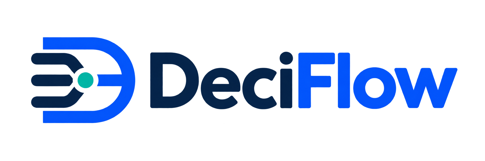
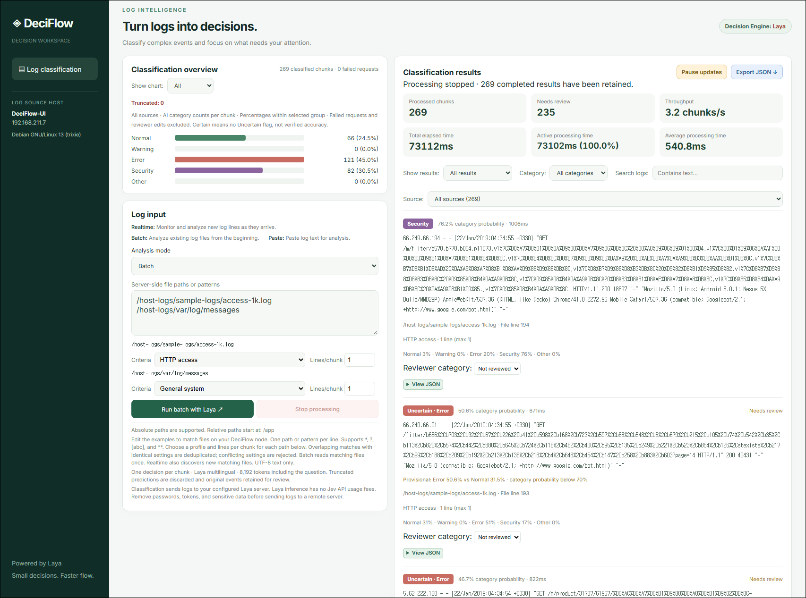
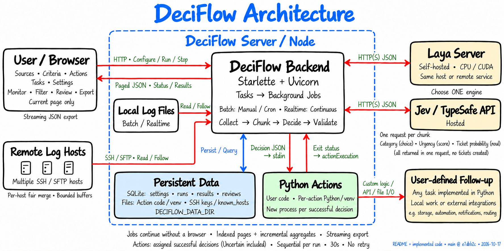

<p align="center">
  
</p>

# DeciFlow

[English](README.md) | [한국어](README.ko.md)

**Classify logs in real time with AI and spot error and security events at a glance.**

[Demo Video](https://www.youtube.com/watch?v=wGMtxpeHHBs)

[](https://www.youtube.com/watch?v=wGMtxpeHHBs)

DeciFlow groups log events into chunks and classifies each chunk as **Normal, Warning, Error, Security, or Other**
with Laya or Jev. Scan a batch, follow new events, and focus your review with
category probabilities and confidence instead of reading every line unaided.
Choose a domain profile and chunk size per source; compare category counts in a
live chart and pause list updates to inspect individual results.

Currently, DeciFlow uses **`choice` decisions only**. Future updates are planned to
add **`score` for evaluation and grading** and **`noul` for yes/no probabilities,
such as pass/fail quality checks**, with criteria and result views tailored to each use case.

**DeciFlow** runs on the node containing your logs, reads events, and displays
results in a browser. The **Laya server** runs the decision model on the same or a separate
host; **Jev** is an alternative hosted decision API. DeciFlow sends events to the
selected engine and receives predictions.

- **Use logs where they live.** Paste text or select multiple files across
  directories with wildcard patterns; no manual file merging.
- **Switch from investigation to monitoring.** Read existing files in batches or
  monitor new lines and file rotation. Newest completed predictions appear first.
- **Keep people in control.** Filter uncertain predictions, record reviewer
  corrections, and export results as JSON. Rejected events retain their original
  text for review.
- **Share inference across nodes.** Run DeciFlow on each log node and connect
  to a shared Laya server; DeciFlow nodes need no local GPU or PyTorch.
- **Choose your engine.** Use self-hosted Laya by default without Jev API charges,
  or select Jev in `.env`. Both use the same workflow; no automatic paid fallback.

For access logs, application errors, and operational events—start with an existing
log file and review the predictions in your browser.

## Architecture

[](https://deepwiki.com/call518/DeciFlow)



## Quick start — Docker + Laya GPU

**Requires:** Git, Docker, a compatible NVIDIA GPU/driver, and
[NVIDIA Container Toolkit](https://docs.nvidia.com/datacenter/cloud-native/container-toolkit/latest/install-guide.html) on one Linux host.
Laya runs the decision engine; DeciFlow runs log analysis and the web UI in a second container.

### 1. Prepare the repository

```bash
git clone https://github.com/call518/DeciFlow.git
cd DeciFlow
# Only if .env does not exist / 기존 .env가 없다면
test -f .env || cp .env.example .env
```

### 2. Start the Laya GPU container

```bash
bash scripts/run-deciflow-laya-cuda.sh
docker logs --follow DeciFlow-Laya-CUDA
```

Wait for the initial model download/loading, then press `Ctrl+C` to leave the log viewer.
[Check readiness](#laya-health) before continuing.

### 3. Configure and start the DeciFlow container

Set these values in `.env`. Replace `<HOST_IP>` with a reachable IP of the host
running both containers. Inside DeciFlow, `127.0.0.1` does not address the Laya host.

```dotenv
DECISION_ENGINE=laya
LAYA_MODEL=multilingual
LAYA_API_URL=http://<HOST_IP>:8000/v1/systemone
LAYA_API_KEY=changeme
PORT=4000
```

```bash
docker build --tag call518/deciflow-ui:0.0.1 .
bash scripts/run-deciflow-ui.sh
```

### 4. Analyze sample logs

Open **http://127.0.0.1:4000** on the same host and select **Batch**.
Keep only `/host-logs/sample-logs/access-100.log`, select **HTTP access** criteria,
**Events/chunk: 1**, and **Action: None**, then start analysis.

Without a GPU, see [Laya CPU](#laya-docker); for a paid API, see [Jev](#jev).
The default key `changeme` is for trials. Change it in both the Laya script and `.env` before deployment.

## Usage and configuration

| Guide | Contents |
| --- | --- |
| [Usage](docs/usage.md) | Input modes, criteria, filters, human review, reconnecting, timing |
| [Configuration](docs/configuration.md) | Environment variables, models, input budgets |
| [Criteria](docs/criteria.md) | Manage fixed-category profiles; Default Criteria is view-only |
| [Python Actions](docs/actions.md) | Configuration viewing, environment Status, pip-enabled environments, Reset venv, revision history, deletion, source assignment |
| [Result JSON](docs/results.md) | Real response example and field reference |

Sidebar views have URLs: Main `/`, Criteria `/#criteria`, Actions `/#actions`.
Reloading, browser history, and direct links retain the selected view.

- **Paste:** Analyze pasted text.
- **Batch:** Analyze existing files. Docker maps host `/var/log` to `/host-logs/var/log`.
- **Realtime:** Follow new logs; choose criteria and chunk size per source.
- **Processing status:** Success / Failed / Total shows classified, failed, and total completed chunks. Action Success / Failed / Total counts follow-up executions separately. Needs review
  counts successful classifications only. Engine connection shows the last actual request; initially Not checked.
- **Review:** Filter Needs review, record corrections, and export JSON. Certain does not
  guarantee accuracy. Export results you need to keep: restarting the server loses jobs/results.

## Docker deployment details

<a id="laya-docker"></a>

### Use the Laya decision engine

Connect to an existing shared Laya server, or set up one on a remote host below.
If a server is already available, skip setup and configure DeciFlow.

The instructions below use Docker run on the Laya host. Docker Compose is an
alternative; see the official guide linked below and choose only one method.

This guide uses Docker to simplify Laya server setup for both CPU and CUDA.
CUDA additionally requires an NVIDIA driver and
[NVIDIA Container Toolkit](https://docs.nvidia.com/datacenter/cloud-native/container-toolkit/latest/install-guide.html).
Check the GPU and driver with `nvidia-smi`: its `CUDA Version` describes driver
support, not the installed Toolkit. `nvcc --version` checks a local Toolkit,
which these containers do not require. A CUDA 13.0 image requires a compatible GPU
and [driver 580 or newer](https://docs.nvidia.com/deploy/cuda-compatibility/minor-version-compatibility.html).

#### Docker run

Use **`call518/deciflow-laya-cpu:0.0.1`** or **`call518/deciflow-laya-cuda:0.0.1`**.
No clone or build is needed. Copy the required script to the Laya host and run
the CPU and/or CUDA commands below. Both containers can run simultaneously.

CPU: [run-deciflow-laya-cpu.sh](scripts/run-deciflow-laya-cpu.sh)

```bash
bash scripts/run-deciflow-laya-cpu.sh
```

CUDA: [run-deciflow-laya-cuda.sh](scripts/run-deciflow-laya-cuda.sh)

```bash
bash scripts/run-deciflow-laya-cuda.sh
```

The scripts explicitly set `--env LAYA_API_KEY=changeme`; exporting a different
key does not override this argument. For deployment, change this argument and set
the same key in DeciFlow's `.env`.

The scripts publish host port **8001 for CPU** and **8000 for CUDA**, preload `english`, `multilingual`, and `typed-decisions`, and share the
`deciflow-laya-model-cache` volume. CUDA exposes all GPUs to the container.
To change the host interface/port, edit `--publish HOST_IP:HOST_PORT:8000` and
update `LAYA_API_URL`. The CPU container is named `DeciFlow-Laya-CPU`; the CUDA
container is named `DeciFlow-Laya-CUDA`. Both containers listen on port 8000
internally. To change settings, stop and
remove the corresponding container before rerunning its script.

> **NOTE:** For Docker Compose deployment, see the official
> [Laya Docker guide — HTTP serving](https://nandhakishorm.github.io/laya/docker/#http-serving).

<a id="laya-health"></a>

#### Check and manage

Use the server's key in `LAYA_API_KEY` for the health request (default: `changeme`).
Set `LAYA_HOST_PORT` to 8001 for CPU or 8000 for CUDA.

```bash
LAYA_HOST_PORT=8001
curl --fail --silent --show-error \
  --header "Authorization: Bearer ${LAYA_API_KEY:-changeme}" \
  "http://127.0.0.1:${LAYA_HOST_PORT}/health"
```

On the DeciFlow node, replace `127.0.0.1` with the server address. Inspect
`checkpoint_devices`/`device` and `cpu_fallbacks` to verify actual GPU use.
Restrict Laya access to trusted DeciFlow nodes and use TLS over external networks.
Keep `LAYA_JEV_STRICT=0` for required truncation metadata. Initial model loading
can take several minutes; inspect container logs for startup errors.

For the commands below, set the name for your deployment:

```bash
LAYA_CONTAINER=DeciFlow-Laya-CPU  # CPU; use DeciFlow-Laya-CUDA for CUDA
```

| Action | Docker run |
| --- | --- |
| Status | `docker ps --filter name=DeciFlow-Laya` |
| Logs | `docker logs --tail=100 "$LAYA_CONTAINER"` |
| Stop | `docker stop "$LAYA_CONTAINER"` |
| Resume | `docker start "$LAYA_CONTAINER"` |
| Remove | `docker rm "$LAYA_CONTAINER"` after stopping |

Removal preserves the model cache. Choose either native execution or Docker;
the CPU and CUDA Docker containers can run together.

#### DeciFlow connection

On the DeciFlow node, set the shared Laya server URL and matching API key in `.env`.
Use port 8001 for the CPU container or 8000 for CUDA (shown below) or native execution:

```dotenv
DECISION_ENGINE=laya
LAYA_MODEL=multilingual
LAYA_API_URL=http://laya-server.example:8000/v1/systemone
LAYA_API_KEY=changeme
PORT=4000
```

<a id="jev"></a>

### Use the Jev decision engine

Obtain a TypeSafe API key from the [Jev setup guide](https://docs.typesafe.ai/introduction/quickstart)
and set it in `.env`. Jev is paid; no Laya server is needed.

```dotenv
DECISION_ENGINE=jev
JEV_MODEL=jev-1.13.0
JEV_API_KEY=your-typesafe-api-key
PORT=4000
```

### DeciFlow Docker

Choose this **instead of the Python startup in the appendix**. The DeciFlow host needs
Docker, not local Python/uv/CUDA. Configure `.env` for either Laya or Jev first;
Laya inference still runs on the separate Laya server.

Run these commands from your cloned DeciFlow directory. The image provides Python, uv, and operational utilities; your repository is mounted read-only at `/app`. On startup,
`uv sync --frozen` installs the checked-out version’s dependencies into a separate
Docker volume. The first startup requires network access for package downloads.

```bash
docker build --tag call518/deciflow-ui:0.0.1 .
bash scripts/run-deciflow-ui.sh
```

The launch script publishes the UI on `0.0.0.0:4000` and mounts sample logs.
The `deciflow-data` volume mounts at `/var/lib/deciflow-data`; Actions use `actions/`
and Criteria use `criteria/`. For local-only access, change the publish address to
`127.0.0.1:4000:4000`. Recreate the container after changing ports/mounts.

Open **http://127.0.0.1:4000**. Host `/var/log` is available as `/host-logs/var/log` in
Batch/Realtime (e.g. `/host-logs/var/log/messages`); mount other directories read-only as needed. If `.env` uses
another `PORT`, adjust both ports in the launch script. For remote browser access, use the
DeciFlow host IP and configure trusted file-access origins as described below.

#### Mount host log directories

Mount host log directories read-only so the DeciFlow container can read them.
The launch script already mounts `/var/log` and the repository's `sample-logs`.
For another directory, add this option to `docker run` in
`scripts/run-deciflow-ui.sh`, replacing `/your/logs` with the host log directory:

```bash
--mount type=bind,src=/your/logs,dst=/host-logs/custom,readonly \
```

After changing mounts, stop/remove the existing container and run the script again.
This loses server-memory jobs/results; export any results you need first.

```bash
docker stop DeciFlow-UI
docker rm DeciFlow-UI
bash scripts/run-deciflow-ui.sh
```

In the UI, enter the **container path `/host-logs/custom/app.log`**, rather than
host path `/your/logs/app.log`. `readonly` prevents the container from modifying
host logs; the DeciFlow process still needs permission to read those files.

#### Connection settings and restart

Use a Laya URL reachable from the container; `127.0.0.1` names the container,
not the host or remote Laya server. Sidebar host/OS/IP information describes the
container. DeciFlow reads the mounted `/app/.env` on each startup; settings supplied
with Docker `--env` take precedence. Restart after changing `.env`:

```bash
docker restart DeciFlow-UI
```

Existing containers created with `--env-file .env` must be recreated once using
the command above and the rebuilt image. Port mappings and mounts still require
container recreation when changed.
For source changes or a different Git version, restart with `docker restart DeciFlow-UI`;
no image rebuild is needed. Refresh the browser after UI changes. Rebuild the image
only when changing the Dockerfile’s runtime. Stop DeciFlow before switching versions.

For ngrok/reverse-proxy file access, set `DECIFLOW_CSRF_TRUSTED_ORIGINS` to the
UI origin, e.g. `https://your-domain.ngrok-free.app`, or
`https://*.ngrok-free.app` for changing ngrok domains (no trailing slash),
and restart the container. Empty allows file access only through localhost.
This setting controls the CSRF Origin check, not CORS, login authentication, or
CSRF token validation. Wildcards also trust other users’ subdomains; protect public
access with proxy authentication.

## Limits

- No application file-size or line-count cap; RAM and browser capacity still matter.
  File reads are incremental. Chunks use an event count; each nonempty line currently forms one event.
  Automatic multiline event-boundary detection is not implemented.
- **Laya:** selected checkpoint; request windows and question budgets are in the [configuration reference](docs/configuration.md).
  The [official HTTP server](https://nandhakishorm.github.io/laya/http-api/#limits)
  also limits state to 50,000 characters and requests to 2 MiB; verify the deployed version.
  Truncated responses or missing truncation metadata are rejected.
- **Jev:** `jev-1.13.0`, [32k state + longest question, 64k full request](https://docs.typesafe.ai/models).
  The byte budget is a conservative guard, not a token count or acceptance guarantee.
- Rejected events retain their original text for review; other events continue.
  Source read/UTF-8 errors stop processing and preserve completed results.
- Each chunk makes one request. Engine concurrency settings default to 4 per run;
  timeouts are Laya 120s and Jev 30s. Higher client concurrency does not guarantee
  parallel inference or higher throughput; server capacity and admission limits apply.
- Realtime polls every 250ms and waits for complete lines. Rotation leftovers are
  marked `incomplete`; line numbers reset on rotation. Rapid rotation or
  copy-truncate/regrowth can lose events. File deduplication does not remove duplicate
  contents; avoid matching both active logs and their rotated copies.
- Laya sends logs to your server; Jev sends them to TypeSafe and incurs API charges.
  DeciFlow does not save logs/results to server disk. Remove sensitive data before
  submission and never commit `.env`. Public deployment needs authentication and
  usage limits.

`Ctrl+C` stops DeciFlow, waiting up to two seconds before cancelling remaining
requests and background jobs. Server-memory jobs and results are lost on shutdown.

## Appendix — Potential applications

Logs are the starting point. Extending input handling and decision criteria could
bring the same workflow to real-time `tcpdump` traffic monitoring or manufacturing
quality decisions based on sensor and inspection data. These applications require
additional integration and domain validation; image inspection also requires a
vision model.

## Appendix — Run directly on the host

Choose this instead of DeciFlow Docker startup. The DeciFlow host needs Python 3.11+
and uv. Use the same Laya Docker server or Jev connection settings; DeciFlow needs no GPU
when connecting to a separate Laya server. Prepare `.env` in the repository and configure
one engine, then run:

```bash
uv sync
uv run python server.py
```

Open **http://127.0.0.1:4000**. Startup creates the default Criteria file, so shared storage must be writable. If the default
`/var/lib/deciflow-data` is not writable, set `DECIFLOW_DATA_DIR=./data`
in `.env`. Restart DeciFlow after configuration changes.

## Appendix — Custom Docker run images (optional)

Build from Laya **v0.4.1** only when you need your own image. Run the CPU **or** CUDA
build command for your target:

```bash
git clone --branch v0.4.1 --depth 1 https://github.com/NandhaKishorM/laya.git
cd laya

docker build \
  --build-arg TORCH_INDEX=cpu \
  --tag my-laya:cpu .

docker build \
  --build-arg TORCH_INDEX=cu130 \
  --tag my-laya:cuda .
```

Replace the image in the chosen Docker run script with your custom tag.
`cpu` installs CPU-only PyTorch; `cu130` means CUDA **13.0**. Select a CUDA build
supported by your GPU/driver and the Dockerfile's `TORCH_VERSION` using the
[PyTorch installation list](https://pytorch.org/get-started/previous-versions/).
Validate API compatibility when upgrading Laya.

## Development

For real-model results and remaining limitations, see [Laya log validation](docs/laya-validation.md).
Re-run the selected Laya model on the 13 labeled examples:

```bash
uv run python -m scripts.evaluate_laya \
  --cases tests/fixtures/general_evaluation.json \
  --output /tmp/laya-validation.json
```

This calls your Laya server only; it refuses paid Jev. The small sample is not an
accuracy guarantee.

```bash
uv run ruff format .
uv run ruff check . --fix
uv run pyright
uv run pytest
```

UI regression test (requires Node.js only for testing):

```bash
node --test tests/test_ui.mjs
```

Tests cover both providers without paid calls, input budgets, streaming,
cancellation, and file discovery/rotation. Keep both READMEs and actual/example
`.env` files synchronized; environment comments use English and Korean.

For optional local Laya development (0.3.20):

```bash
uv sync --extra laya
uv run --extra laya python laya_server.py
```

Set DeciFlow's `LAYA_API_URL` to loopback and start DeciFlow in another terminal. Use this
adapter for 0.3.20; it adds token-budget checks and truncation metadata missing from
that version's HTTP server. Set local server options through process environment
variables. DeciFlow nodes using a separate Laya server do not need the `laya` extra.

[Laya](https://github.com/NandhaKishorM/laya) · [Jev](https://docs.typesafe.ai/introduction/quickstart)
